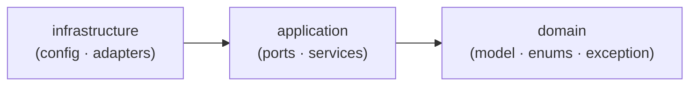
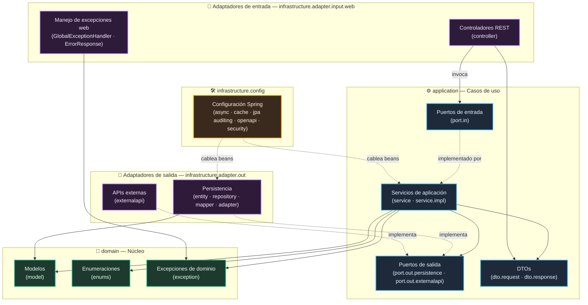

# FIND-U CORE — Arquitectura Hexagonal Canónica

> Documento de arquitectura del microservicio **findu-core** tras su reestructuración a la
> arquitectura hexagonal (puertos y adaptadores) **canónica** ya adoptada por los módulos
> hermanos del CORE: **findu-transaction** (`com.findu.transaction`) y
> **findu-help-v2** (`com.findu.help.v2`).
>
> La migración fue un refactor **puramente mecánico de paquetes/estructura**: se movieron clases
> entre paquetes y se ajustaron declaraciones `package`, `import` y referencias de
> MapStruct/anotaciones. **No hubo cambio de comportamiento**: sin renombrados de clases, sin
> cambios de firma, sin cambios de lógica, sin cambios de rutas REST, sin cambios en campos de DTO,
> sin cambios en tablas/columnas JPA ni en nombres de beans de Spring.

## 1. La arquitectura canónica adoptada

Todos los microservicios del CORE comparten la misma organización en tres capas concéntricas.
De dentro hacia fuera:

- **`domain`** — El núcleo del negocio. Modelos (entidades de dominio), enumeraciones y
  excepciones de dominio. No conoce frameworks, ni HTTP, ni base de datos.
- **`application`** — La capa de orquestación de casos de uso. Define los **puertos** (contratos)
  y contiene los **servicios** que los implementan:
  - **`application.port.in`** — Puertos de entrada (interfaces de casos de uso) que la
    infraestructura invoca.
  - **`application.port.out`** — Puertos de salida (contratos hacia persistencia y APIs externas)
    que la infraestructura implementa.
  - **`application.service`** — Servicios de aplicación que implementan los puertos de entrada y
    orquestan el dominio apoyándose en los puertos de salida.
- **`infrastructure`** — Los detalles técnicos (adaptadores) y la configuración:
  - **`infrastructure.config`** — Configuración de Spring (async, caché, auditoría JPA, OpenAPI,
    seguridad).
  - **`infrastructure.adapter.in.web`** — Adaptadores de entrada: controladores REST y el manejo
    de excepciones web.
  - **`infrastructure.adapter.out.persistence`** — Adaptadores de salida de persistencia:
    entidades JPA, repositorios Spring Data, mappers MapStruct y adaptadores que implementan los
    puertos de salida.

> **Nota de nomenclatura.** El boceto canónico del requerimiento usa `adapter.in.web` y
> `adapter.out`. Los dos módulos de referencia reales (`findu-transaction`, `findu-help-v2`) usan
> literalmente `adapter.input.web` y `adapter.out`, y la premisa del refactor fue **copiar la
> convención exacta de las referencias**. Por eso en findu-core el paquete físico es
> `infrastructure.adapter.input.web` (equivalente conceptual a `adapter.in.web`) y
> `infrastructure.adapter.out`.

## 2. La regla de dependencia

Las dependencias apuntan **siempre hacia adentro**. Una capa solo puede conocer a las capas más
internas, nunca a las externas.

- **`domain`** no depende de nada (ni de `application`, ni de `infrastructure`, ni de frameworks).
- **`application`** depende **solo** de `domain`.
- **`infrastructure`** depende de `application` **y** de `domain`.

La inversión de dependencias se logra con los **puertos**: la aplicación declara interfaces
(`port.out`) y la infraestructura las implementa (adaptadores de salida); la infraestructura
invoca interfaces (`port.in`) implementadas por los servicios de aplicación. Así el núcleo nunca
depende de un detalle técnico concreto.



## 3. Estructura de paquetes canónica

```
com.findu.core
├── FinduCoreApplication            (raíz: @SpringBootApplication — se mantiene aquí para el scan por defecto)
├── domain
│   ├── model                       (entidades/modelos de dominio)
│   ├── enums                       (EstadoPerfil, NotificationTemplates)
│   └── exception                   (ResourceNotFoundException)
├── application
│   ├── dto
│   │   ├── request                 (DTOs de petición)
│   │   └── response                (DTOs de respuesta)
│   ├── port
│   │   ├── in                      (puertos de entrada — interfaces de casos de uso)
│   │   └── out
│   │       ├── persistence         (puertos de salida de persistencia)
│   │       └── externalapi         (puertos de salida hacia APIs externas)
│   ├── service                     (servicios de aplicación: implementaciones de casos de uso)
│   │   └── impl                    (capa de servicios preexistente — preservada tal cual)
│   └── util                        (DateUtils, ApiMessages)
└── infrastructure
    ├── config                      (AsyncConfig, CacheConfig, JpaAuditingConfig, LocalCacheConfig, OpenApiConfig)
    │   └── security                (package-info de seguridad)
    └── adapter
        ├── input
        │   └── web
        │       ├── controller      (controladores REST)
        │       └── exception       (GlobalExceptionHandler, ErrorResponse)
        └── out
            ├── persistence
            │   ├── entity          (entidades JPA)
            │   ├── repository      (repositorios Spring Data)
            │   ├── mapper          (mappers MapStruct dominio↔entidad)
            │   └── adapter         (*RepoAdapter — implementan los puertos de salida)
            └── externalapi         (NotificationLambdaAdapter, StorageServiceStubAdapter)
```

> `FinduCoreApplication` permanece en el paquete raíz `com.findu.core` con un
> `@SpringBootApplication` sin `scanBasePackages`. Como todos los paquetes siguen bajo
> `com.findu.core.*`, el *component scan*, el *entity scan* y el *repository scan* por defecto los
> siguen cubriendo sin necesidad de anotaciones adicionales.

## 4. Mapeo de migración: paquete findu-core anterior → paquete nuevo

Tabla completa de la migración aplicada (todos los paquetes bajo `com.findu.core.…`):

| # | Paquete anterior | Paquete nuevo | Notas |
|---|---|---|---|
| 1 | `` (raíz: `FinduCoreApplication`) | `` (sin cambios) | Se mantiene en la raíz para el scan por defecto |
| 2 | `domain.model` | `domain.model` | Sin cambios (entidades/modelos de dominio) |
| 3 | `domain.model.constants` | `domain.enums` | `EstadoPerfil`, `NotificationTemplates` |
| 4 | `exception` → `ResourceNotFoundException` | `domain.exception` | Excepción de dominio |
| 5 | `exception` → `GlobalExceptionHandler`, `ErrorResponse` | `infrastructure.adapter.input.web.exception` | Concern web (handler + DTO de error) |
| 6 | `application.usecase` (interfaces UseCase) | `application.port.in` | Puertos de entrada |
| 7 | `application.usecase.impl` (impl. UseCase) | `application.service` | Las impl. de casos de uso pasan a ser servicios de aplicación |
| 8 | `application.service` (interfaces de servicio existentes) | `application.service` | Sin cambios — segunda capa de servicio preservada |
| 9 | `application.service.impl` (impl. de servicio existentes) | `application.service.impl` | Sin cambios — preservada tal cual |
| 10 | `application.port.output.persistence` | `application.port.out.persistence` | `output` → `out` |
| 11 | `application.port.output.externalapi` | `application.port.out.externalapi` | `output` → `out` |
| 12 | `application.util` | `application.util` | Sin cambios |
| 13 | `messages` → `ApiMessages` | `application.util` | Helper de constantes de mensajes; hogar util coherente |
| 14 | `dto.request` | `application.dto.request` | Los servicios de aplicación devuelven DTOs (evita inversión app→infra) |
| 15 | `dto.response` | `application.dto.response` | Igual que el anterior |
| 16 | `config` (5 clases) | `infrastructure.config` | `AsyncConfig`, `CacheConfig`, `JpaAuditingConfig`, `LocalCacheConfig`, `OpenApiConfig` |
| 17 | `config.security` | `infrastructure.config.security` | Contiene `package-info.java` |
| 18 | `presentation.controller` | `infrastructure.adapter.input.web.controller` | Controladores REST |
| 19 | `infrastructure.entity` | `infrastructure.adapter.out.persistence.entity` | Entidades JPA |
| 20 | `infrastructure.repository` | `infrastructure.adapter.out.persistence.repository` | Repositorios Spring Data |
| 21 | `infrastructure.adapter.persistence` (`*RepoAdapter`) | `infrastructure.adapter.out.persistence.adapter` | Adaptadores puerto→repositorio |
| 22 | `mapper` | `infrastructure.adapter.out.persistence.mapper` | Mappers MapStruct dominio↔entidad |
| 23 | `infrastructure.adapter.externalapi` | `infrastructure.adapter.out.externalapi` | Adaptadores de salida hacia APIs externas |

> **Dos capas de servicio conviven.** Las interfaces/implementaciones preexistentes
> (`application.service` / `application.service.impl`) se preservan intactas; las impl. de los
> casos de uso (antes `application.usecase.impl`) se mueven a `application.service` como pares.
> Nada se renombra, fusiona ni elimina.
>
> **Hogar de los DTO.** Se ubicaron en `application.dto.{request,response}` en lugar de la capa web
> porque los servicios de aplicación de findu-core devuelven DTOs. Colocarlos en la infraestructura
> habría forzado una dependencia `application → infrastructure` (inversión de capas). Esta es la
> opción que preserva el comportamiento.

## 5. Diagrama hexagonal (puertos y adaptadores)

> Convención de líneas:
> - Línea sólida (`-->`): dependencia directa / invocación.
> - Línea punteada (`-.->`): implementación de un puerto (inversión de dependencias).
>
> El color de relleno indica la capa (ver leyenda).



## Leyenda

| Color | Capa |
|-------|------|
| 🟢 Verde | **domain** — núcleo del negocio (no depende de nada) |
| 🔵 Azul | **application** — puertos y servicios (depende solo de domain) |
| 🟣 Morado | **adaptadores** de entrada/salida (depende de application + domain) |
| 🟠 Naranja | **infrastructure.config** — configuración y cableado de Spring |

## Notas de la vista

- El refactor fue **mecánico y sin cambios de comportamiento**: solo movimientos de paquetes y
  ajustes de `package`/`import`/referencias de anotaciones.
- La misma estructura canónica (`domain` / `application[port.in, port.out, service]` /
  `infrastructure[config, adapter.in.web, adapter.out.persistence]`) rige para los tres
  microservicios del CORE, lo que facilita leer y mantener cualquiera de ellos partiendo del mismo
  mapa mental.
- Los adaptadores de salida (`persistence`, `externalapi`) **implementan** los puertos declarados
  por la capa de aplicación; de ahí las flechas punteadas hacia `port.out`. Esta es la inversión
  de dependencias que mantiene el núcleo libre de detalles técnicos.
